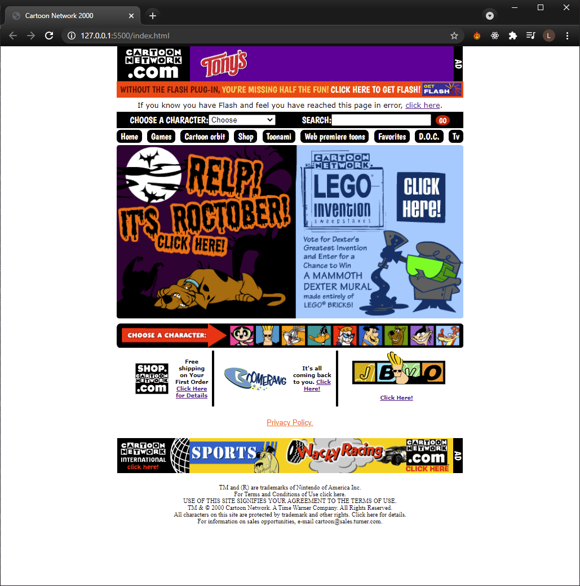
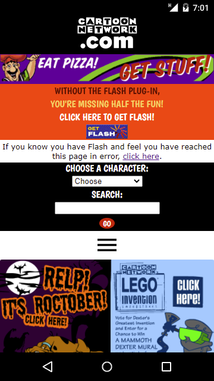

> 🗄️ This project is complete and archived. It's kept as a learning showcase — check out the [live demo](https://lmendev.github.io/CartoonNetwork-2000-Clone/)!
# CartoonNetwork in 2000 | Web Page Clone
Clone of Cartoon Network website in 00's for educational purposes.

## Desktop
This is the clone result 🙂

## Mobile version 😃
If we had smartphones in the 00's, it would have looked something like this:

